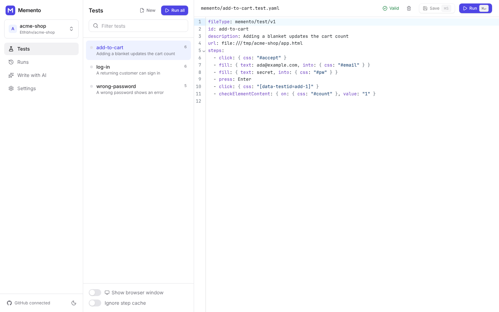

# Memento

**Open-source, bring-your-own-AI end-to-end testing.** Write web tests in plain
English, run them locally on real browsers, and use whichever models you like —
Claude, GPT, Gemini, or a local model through Ollama / LM Studio.

Memento follows the same idea as [Momentic](https://momentic.ai) — tests are
readable YAML files in your repo, elements are found from natural-language
descriptions, AI actions reach goals on their own, and everything AI resolves
is cached so green runs are fast and deterministic — but it is open source,
runs on your machine, and lets you plug in your own AI and infrastructure.



## What a test looks like

```yaml
fileType: memento/test/v1
id: guest-checkout
url: https://shop.example.com
before:
  - if:
      checkElementVisible: the cookie banner
      then:
        - click: Accept all
steps:
  - module: ./modules/log-in.module.yaml
  - click: the Add to cart button for 'Gravity Blanket'
  - assert: The cart badge shows 1 item
  # An AI action: the agent figures out the clicks, an independent
  # reviewer checks the postcondition, and the path is cached for next time.
  - act:
      goal: Check out as a guest using a fresh email
      postcondition: An order confirmation with an order number is shown
  - extract:
      goal: the order number
      saveAs: ORDER_ID
```

Mix three kinds of steps freely:

- **Preset steps** (`click`, `type`, `fill`, `select`, `navigate`, checks, network
  mocks, `javascript`, …) — explicit and reviewable. Targets are
  natural-language descriptions, CSS, XPath or coordinates.
- **AI steps** — `assert` (checked against DOM + accessibility tree +
  screenshot), `assertVisually`, `extract` (JSON-schema output), and `act`
  (goal-driven agent with protected pre/postconditions).
- **Modules** — reusable, parameterised step sequences (log in, seed data).

Plus `if`/`else`, `while`, `retries`, soft assertions, variables and `{{ }}`
templating. Momentic `momentic/test/v2` YAML files load as-is.

## Quick start

Memento is a local web app plus a CLI. The website runs on your computer
(`127.0.0.1`), and tests run in real browsers on your computer.

```bash
git clone https://github.com/Etlhbhv/memento.git && cd memento
pnpm install && pnpm build
```

```bash
npx playwright install chromium
```

```bash
node packages/cli/dist/bin.js ui
```

This opens the app in your browser. From there:

1. **Open a project**: pick a folder, or connect GitHub and pick a repository
   (it's cloned to `~/.memento/repos`).
2. **Settings → AI models**: add a provider (Anthropic, OpenAI, Gemini,
   OpenRouter, Ollama, LM Studio…) and paste your key. Keys stay in
   `~/.memento/credentials.json` on your machine, never in the project.
3. **Write with AI**: Memento reads the code and drafts tests. Save them, or
   open a pull request, optionally with a workflow that runs the tests on
   every PR and comments the results.
4. **Tests**: edit, run, and watch each step live. **Runs** keeps history,
   screenshots and Playwright traces.

To use `memento` as a command anywhere: `cd packages/cli && pnpm link --global`.

### CLI

```bash
memento run                      # run all tests
memento run memento/login.test.yaml --headed
memento run --summary-md summary.md --junit junit.xml   # CI reports
memento doctor                   # check config, browser and every model
memento trace <path/to/trace.zip>
```

## GitHub

Connect with your GitHub CLI login (`gh auth login`) or a fine-grained token
(Contents, Pull requests and Workflows: read & write). Memento then can:

- clone a repository and **read its code to write tests** (routes, pages,
  forms, labels),
- **commit tests on a branch and open a pull request**,
- add `.github/workflows/memento.yml`, which **runs the suite on every pull
  request** and posts a results comment. It needs an AI key secret (e.g.
  `ANTHROPIC_API_KEY`) and a `MEMENTO_BASE_URL` variable pointing at a preview
  or staging deployment.

## Bring your own AI

```yaml
# memento.config.yaml
ai:
  providers:
    anthropic: { type: anthropic, apiKey: "${ANTHROPIC_API_KEY}" }
    local:     { type: openai-compatible, baseURL: http://localhost:11434/v1, vision: false }
    router:    { type: openai-compatible, baseURL: https://openrouter.ai/api/v1, apiKey: "${OPENROUTER_API_KEY}" }
  models:
    default: anthropic:claude-sonnet-5-5
    locator: local:qwen2.5:14b              # frequent, simple calls → cheap/local
    assertion: anthropic:claude-haiku-5-5
    act: [anthropic:claude-opus-5-5, router:openai/gpt-5]   # fallback chain
```

Each agent (`locator`, `assertion`, `extract`, `act`, `review`, `recovery`)
can use a different model. Agents only use **structured JSON output**, not
provider tool calling, so smaller local models work too. The prompts live in
[`packages/core/src/ai/prompts.ts`](packages/core/src/ai/prompts.ts) and can be
overridden.

## How it works

1. **Snapshot.** The page is turned into a compact, numbered element tree
   (DOM + accessibility roles/names, testing attributes kept, noise pruned),
   optionally with a screenshot. The model picks an element *id*; it never
   writes selectors.
2. **Cache.** A resolved element is stored with several independent selectors
   and the signals the model said it relied on (text, role, attributes,
   position). Next run, selectors vote for an element and only those signals
   are checked — **no model call**. If they no longer hold, the AI re-resolves
   the description (auto-heal) and the cache updates. Only passing runs write
   the cache. AI actions cache their whole trajectory.
3. **Smart waiting.** Before acting, Memento waits for the network and DOM to
   go quiet (bounded), so tests don't need sleeps.
4. **Recovery** (opt-in). A failed preset step can trigger an agent that
   clears transient obstructions (cookie banners, promo modals) and retries —
   it never edits the test and refuses to paper over real failures.
5. **Knowledge.** `.memento/knowledge/*.yaml` holds product terminology,
   agent-specific rules and known flows, injected into relevant prompts.

See [docs/research/momentic.md](docs/research/momentic.md) for the research
this design is based on and [docs/ROADMAP.md](docs/ROADMAP.md) for parity
status.

## Repository layout

```
packages/core     test format, AI layer + agents, browser snapshot, cache, runner, test author
packages/server   local API server: projects, runs (live events), settings, GitHub
packages/cli      `memento` command (`memento ui` starts the server + web app)
apps/web          React web app
docs/             research notes and roadmap
```

## Development

```bash
pnpm install
pnpm build
pnpm test          # unit, server/API and real-Chromium e2e tests (scripted fake model)
pnpm --filter @memento/web dev   # UI dev server; run `memento ui --port 4321` alongside
```

If Playwright can't find a browser, set `MEMENTO_BROWSER_PATH` to a
Chromium binary or run `npx playwright install chromium`.

> JavaScript steps run in a `node:vm` context. That separates variables but
> is **not** a security sandbox — only run test suites you trust.

## License

MIT
